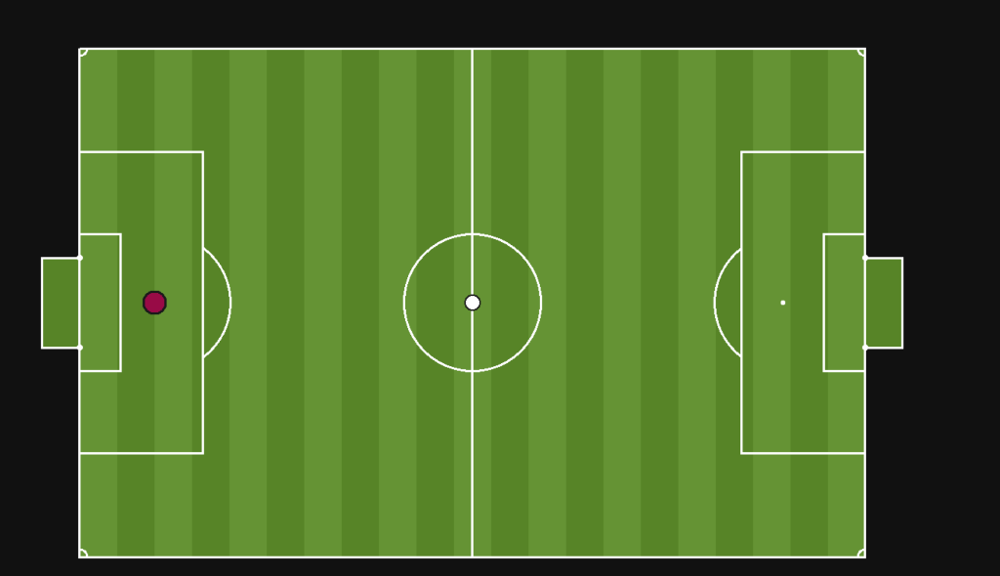
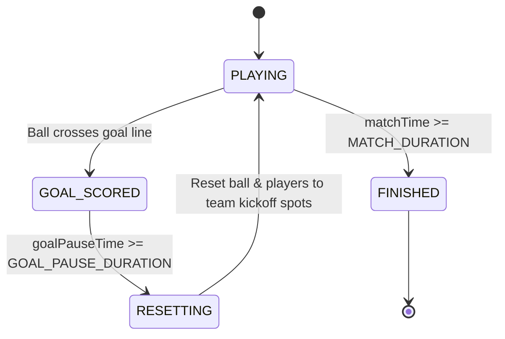

# ⚽ The Ball Game

> A fast-paced, top-down 2D physics soccer game built from scratch in TypeScript, powered by PixiJS for rendering and a headless, zero-dependency physics simulation engine architected for authoritative multiplayer.



---

## 🎯 What is This?

**The Ball Game** is an arcade-style, physics-driven 2D soccer game inspired by classic multiplayer browser games like HaxBall. 

Instead of slapping together a quick prototype inside a monolithic rendering loop, this project is built from first principles:
- **Custom 2D Vector Math & Physics**: Circle-circle elastic collisions, momentum conservation with restitution, directional impulse kicking, and line-segment pitch boundary reflections.
- **Strict Separation of Concerns**: Game logic and physics know **nothing** about PixiJS, canvases, or the DOM. The entire simulation runs headless and communicates via immutable state snapshots.
- **Multiplayer-Ready Architecture**: The simulation natively supports multiple players with team assignments (`RED` / `BLUE`), per-player input mapping, and independent kickoff spawning. A shared protocol (`shared/protocol.ts`) binds the client and the authoritative Socket.io server.

---

## 📍 Development Progress & Status

| Checkpoint | Status | Description |
|---|:---:|---|
| **Checkpoint 1** | ✅ | **Core Physics & Kinematics**: Player acceleration/deceleration, ball friction, circle collisions with de-penetration, momentum-conserving impulse resolution, and edge-triggered kicking. |
| **Checkpoint 2** | ✅ | **Pitch & Match Rules**: FIFA-scaled pitch geometry, goal net detection, score tracking, match timer, and match lifecycle states (`PLAYING` $\to$ `GOAL_SCORED` $\to$ `RESETTING` $\to$ `FINISHED`). |
| **Checkpoint 3** | ✅ | **Headless Architecture Split**: Simulation completely divorced from PixiJS. Introduction of `PhysicsBody`, `SimulationSnapshot`, decoupled `PlayerInput`, and dedicated renderers. |
| **Checkpoint 4** | 🚧 *(In Progress)* | **Multiplayer Simulation & Networking**: Multi-player support in simulation layer, team spawns, shared network protocol (`shared/protocol.ts`), Socket.io server connection loop, player join/leave lifecycle, and client input streaming. |

---

## 🏗️ Architecture & Simulation Pipeline

The engine separates responsibilities into **Simulation (Model)**, **Renderers (View)**, **Networking (Transport)**, and **Client Orchestrator (Controller)**.

```
       [ Keyboard / DOM ]
               │
               ▼
      [ PlayerInputReader ]
               │
         PlayerInput { move, kick }
         ┌─────┴───────────────────────┐
         │ (Local Input)               │ (Stream to Server via Socket.io)
         ▼                             ▼
    ┌──────────────────────┐      ┌─────────────────────────┐
    │     Game.update()    │      │    Socket.io Server     │
    │  - Multi-Player Map  │      │  - Player Sessions      │
    │  - Team Kinematics   │      │  - Input Aggregation    │
    │  - Collision System  │      │  - Shared Protocol DTOs │
    │  - Goal Detection    │      └─────────────────────────┘
    │  - Match State       │
    └──────────┬───────────┘
               │  SimulationSnapshot (Plain DTO)
               ▼
    ┌──────────────────────┐
    │      GameClient      │  <--- Presentation & Network Bridge
    └──────────┬───────────┘
               │
         ┌─────┴─────┐
         ▼           ▼
   [PlayerRenderer] [BallRenderer]  <--- PixiJS v8 Display Objects
```

### 1. Multi-Player Headless Simulation (`Game.ts`)
The `Game` class has **zero PixiJS imports**. It manages a dynamic map of players (`Map<string, PlayerData>`) across teams (`RED` / `BLUE`):
- Supports runtime player joins (`addPlayer(id, team)`).
- Assigns kickoff positions based on team side (RED spawns on the left, BLUE on the right).
- Accepts a frame input map (`PlayerInputs = Map<string, PlayerInput>`) to advance all players concurrently.
- Evaluates per-player ball collisions and kick attempts.
- Emits an immutable **`SimulationSnapshot`** describing the entire field state.

### 2. The Shared Network Protocol (`shared/protocol.ts`)
A dedicated protocol module provides type-safe contracts shared between client and server without duplicating interfaces:
```typescript
export type PlayerInput = {
    up: boolean;
    down: boolean;
    left: boolean;
    right: boolean;
    kick: boolean;
};

export type ClientMessage = {
    type: "input";
} & PlayerInput;

export type NetworkPlayer = {
    id: string;
    x: number;
    y: number;
    vx: number;
    vy: number;
};

export type GameSnapshot = {
    players: NetworkPlayer[];
    ball: { x: number; y: number; vx: number; vy: number };
    score: { left: number; right: number };
    timer: number;
    phase: MatchPhase;
};

export type ServerMessage =
    | { type: "welcome"; playerId: string }
    | { type: "state"; snapshot: GameSnapshot };
```

### 3. Bidirectional Socket.io Networking (`server/` & `GameClient.ts`)
- **Transport Upgrade**: Handshakes over HTTP and automatically upgrades to persistent, low-latency WebSocket transport.
- **Connection Lifecycle**: Tracks player connects and disconnects, assigns unique IDs, and broadcasts `playerJoined` and `playerLeft` events.
- **Input Streaming**: The client captures input per frame and streams it to the server (`type: "input"`).
- **State Broadcast Plumbing**: The server aggregates player inputs and broadcasts state ticks back to connected clients.

### 4. Dedicated Renderers (`src/render/`)
`FieldRenderer`, `PlayerRenderer`, and `BallRenderer` extend PixiJS graphics classes. They know only how to draw themselves and expose simple `.sync()` methods to update visual coordinates from snapshot data.

---

## 🔬 Physics & Mechanics Under the Hood

### 1. Ball Friction & Decay

The ball maintains velocity across frames rather than moving on constant player push. Friction is modeled as exponential velocity decay:

$$
\vec{v}_{\text{next}} = \vec{v} \cdot (1 - \mu \cdot dt)
$$

To prevent floating-point micro-drift where the ball crawls at infinitesimal speeds, an $\epsilon$-threshold zeroes the velocity when $|\vec{v}|^2 < \epsilon^2$.

### 2. Circle-Circle Collision & Positional De-penetration

When detecting whether the ball and player collide, calculating square roots ($\sqrt{\Delta x^2 + \Delta y^2}$) every frame is costly. We check distance squared against radius sum squared first:

$$
\Delta x^2 + \Delta y^2 \le (r_{\text{player}} + r_{\text{ball}})^2
$$

If overlapping:

1. **De-penetration**: Calculate true overlap and shift both bodies apart along the collision normal $\hat{n}$ by half the overlap to resolve physical intersection:

$$
\vec{x}_{\text{correction}} = \hat{n} \cdot \frac{\text{overlap}}{2}
$$

2. **Impulse Resolution**: Conserves momentum based on Newton's third law and the coefficient of restitution $e$:

$$
J = \frac{-(1 + e)(\vec{u}_1 - \vec{u}_2) \cdot \hat{n}}{\frac{1}{m_1} + \frac{1}{m_2}}
$$

Because the player is significantly heavier than the ball ($m_{\text{player}} \gg m_{\text{ball}}$), the ball absorbs the vast majority of the impulse velocity while the player barely flinches.

### 3. Kicking as an Instantaneous Impulse

Kicking is not a sustained force; it's a discrete impulse.

- **Edge-triggered detection**: Requires spacebar to transition from *unpressed* $\to$ *pressed* (preventing kick spamming by holding the key).
- **Proximity validation**: Allowed only when the distance between player and ball is within kick range.
- **Directional Impulse**: Injects an instantaneous velocity boost along the line connecting player center to ball center:

$$
\Delta \vec{v}_{\text{ball}} = \frac{\text{Impulse}}{m_{\text{ball}}}
$$

### 4. Wall & Goal Boundary Physics

- Field boundaries are decomposed into mathematical `LineSegment` primitives.
- Wall collisions find the closest point on the line segment, project the collision normal, de-penetrate the ball, and reflect the velocity vector $\vec{v}' = \vec{v} - 2(\vec{v} \cdot \hat{n})\hat{n}$ scaled by wall restitution.
- Goal posts are modeled as circular pegs rather than sharp rectangular boxes to yield natural, curved deflections.

---

## ⏱️ Match Lifecycle & State Machine

The game runs a finite state machine inside `Game.update()`:



- **`PLAYING`**: Full physics integration, multi-player collision detection, and input processing active.
- **`GOAL_SCORED`**: Physics freezes immediately. Velocities are zeroed across all players and the ball to prevent accidental ricochets or double-goal triggers. Score is awarded to the opposing side.
- **`RESETTING`**: Positions snap back to team kickoff coordinates, timers reset, and play resumes.
- **`FINISHED`**: Match concludes once the match timer expires.

---

## 📂 Project Structure

```
The-Ball-Game/
├── client/
│   ├── index.html
│   ├── package.json               # PixiJS v8, Socket.io-client, Vite, TypeScript
│   ├── tsconfig.json
│   ├── public/                    # Favicons and SVG assets
│   └── src/
│       ├── main.ts                # Application bootstrap & Pixi ticker
│       ├── GameClient.ts          # Bridge orchestrating Input -> Socket -> Game -> Renderers
│       ├── Game.ts                # Pure headless multi-player simulation
│       ├── game/
│       │   ├── GameState.ts       # Match state enum (PLAYING, GOAL_SCORED, etc.)
│       │   ├── GoalDetector.ts    # Geometric goal line detection
│       │   ├── MatchState.ts      # Score counters and timers
│       │   ├── PlayerData.ts      # Team types & player body metadata
│       │   └── SimulationSnapshot.ts # Flat DTO contract between sim & view
│       ├── input/
│       │   ├── Input.ts           # Low-level DOM keyboard listener
│       │   ├── PlayerInput.ts     # Re-export from shared protocol
│       │   └── PlayerInputReader.ts # Samples Input into PlayerInput
│       ├── math/
│       │   └── Vector2.ts         # Custom 2D vector class
│       ├── objects/
│       │   ├── Ball.ts            # Ball physics state & friction
│       │   ├── Field.ts           # Pitch dimensions & boundary segment geometry
│       │   └── Player.ts          # Player physics state & movement kinematics
│       ├── physics/
│       │   ├── PhysicsBody.ts     # Base class (position, velocity, radius, mass)
│       │   ├── Collision.ts       # Collision contact data
│       │   ├── CollisionSystem.ts # Generic body & boundary resolution
│       │   ├── boundary/          # LineSegment & boundary shapes
│       │   └── geometry/          # Closest-point algorithms
│       └── render/
│           ├── BallRenderer.ts    # PixiJS ball visual sync
│           ├── FieldRenderer.ts   # PixiJS pitch lines, markings & goal nets
│           └── PlayerRenderer.ts  # PixiJS player visual sync
├── server/
│   ├── package.json               # Socket.io, tsx, TypeScript
│   └── src/
│       └── index.ts               # Socket.io game server & connection manager
├── shared/
│   └── protocol.ts                # Shared network protocol types (DTOs & events)
└── docs/
    └── gameplay.png               # In-game pitch screenshot
```

---

## 🎮 Controls

| Action | Key(s) |
|---|---|
| **Move** | `W`, `A`, `S`, `D` or Arrow Keys |
| **Kick** | `Spacebar` (when near the ball) |

---

## 🚀 Getting Started

### Prerequisites
- [Node.js](https://nodejs.org/) (v18 or higher recommended)
- `npm` or `pnpm`

### Installation & Run

1. **Clone the repository:**
   ```bash
   git clone https://github.com/your-username/The-Ball-Game.git
   cd The-Ball-Game
   ```

2. **Start the Socket.io Server:**
   ```bash
   cd server
   npm install
   npm run dev
   ```
   The server will start listening on `http://localhost:3000`.

3. **Start the Game Client:**
   In a separate terminal window:
   ```bash
   cd client
   npm install
   npm run dev
   ```
   Open `http://localhost:5173` in your browser. Open multiple tabs to test connection and player tracking events in the server logs!

---

## 💡 Engineering Insights & Lessons Learned

- **Decoupled Simulation Enables Server Portability**: Because `Game.ts` does not touch PixiJS or the DOM, the exact same simulation can run inside a Node.js process without polyfills or mocks.
- **Shared Protocol Contracts**: Maintaining a single `shared/protocol.ts` imported by both client and server eliminates contract mismatches and keeps network payloads strictly typed.
- **Multi-Entity Map Architecture**: Transitioning from a single `this.player` instance to a `Map<string, PlayerData>` with team designations cleanly generalized collision loops, kick checks, and goal resets for any number of players.
- **Sockets vs. HTTP Polling**: In high-frequency 2D games, client-to-server input must stream continuously, and server-to-client snapshots must push unprompted. A persistent WebSocket channel (via Socket.io) guarantees low-latency, bidirectional streaming with automatic HTTP long-polling fallback.

---

## 🗺️ Roadmap

- [x] **2D Vector & Kinematic Physics System**
- [x] **Momentum conservation collisions & impulse kicks**
- [x] **FIFA-proportional pitch geometry and goal validation**
- [x] **Decoupled Headless Simulation (Checkpoint 3)**
- [x] **Multi-player readiness in simulation layer (player map, teams, per-player inputs)**
- [x] **Shared network protocol (`shared/protocol.ts`)**
- [x] **Socket.io connection handshake & input streaming plumbing (Checkpoint 4)**
- [ ] **Authoritative server-side game tick (migrating `Game.update` to Node.js server)**
- [ ] **Multi-client visual rendering (spawning dynamic `PlayerRenderer` instances per network player)**
- [ ] **Multiplayer room matchmaking & 1v1 / 2v2 support**
- [ ] **Client-side prediction, server reconciliation, and entity interpolation**
- [ ] **Dynamic scoreboard UI, goal celebrations, and instant replay queue**
