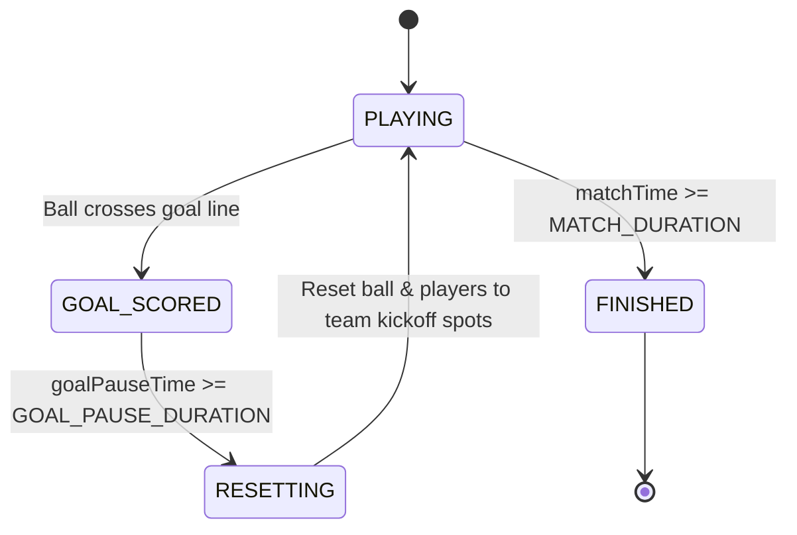

# ⚽ The Ball Game

> A fast-paced, top-down 2D physics soccer game built from scratch in TypeScript, powered by PixiJS for rendering and a headless, zero-dependency physics simulation engine with an authoritative Node.js multiplayer server.


---

## 🎯 What is This?

**The Ball Game** is an arcade-style, physics-driven 2D soccer game inspired by classic multiplayer browser games like HaxBall. 

Instead of slapping together a quick prototype inside a monolithic rendering loop, this project is built from first principles:
- **Custom 2D Vector Math & Physics**: Circle-circle elastic collisions, player-player body collisions, momentum conservation with restitution, directional impulse kicking, and line-segment pitch boundary reflections.
- **Strict Separation of Concerns**: Game logic and physics know **nothing** about PixiJS, canvases, or the DOM. The entire simulation runs headless inside [`shared/game/`](shared/game/) and communicates via immutable state snapshots.
- **Server-Authoritative Multiplayer**: The Node.js server owns the official simulation tick (60 Hz) and streams world snapshots (20 Hz) over Socket.io. The client is a thin visual renderer that captures local inputs and displays server snapshots.

---

## 📍 Development Progress & Status

| Checkpoint | Status | Description |
|---|:---:|---|
| **Checkpoint 1** | ✅ | **Core Physics & Kinematics**: Player acceleration/deceleration, ball friction, circle collisions with de-penetration, momentum-conserving impulse resolution, and edge-triggered kicking. |
| **Checkpoint 2** | ✅ | **Pitch & Match Rules**: FIFA-scaled pitch geometry, goal net detection, score tracking, match timer, and match lifecycle states (`PLAYING` $\to$ `GOAL_SCORED` $\to$ `RESETTING` $\to$ `FINISHED`). |
| **Checkpoint 3** | ✅ | **Headless Architecture Split**: Simulation completely divorced from PixiJS. Introduction of `PhysicsBody`, `SimulationSnapshot`, decoupled `PlayerInput`, and dedicated renderers. |
| **Checkpoint 4** | ✅ | **Authoritative Multiplayer & Shared Simulation**: Full migration of headless simulation to `shared/game/`, authoritative 60 Hz server loop, 20 Hz snapshot broadcasting, dynamic multi-client sprite management, browser blur/tab-switch input flush, and multi-tab local testing. |
| **Milestone 1** | 🎯 *(Up Next)* | **Online Server Hosting**: Deploy Node.js server to a public host and point client connection to remote address for cross-device play. |
| **Milestones 2–5** | 📋 *(Planned)* | **Real-Network Verification, Movement Quality (Interpolation/Prediction), Lobbies/Rooms, and Frontend Polish**. |

---

## 🏗️ Architecture & Simulation Pipeline

The engine cleanly separates responsibilities into **Shared Simulation (Model)**, **PixiJS Renderers (View)**, **Socket.io (Transport)**, and **Authoritative Server (Controller)**.

```
  [Browser Client A]                         [Node.js Authoritative Server]
  ┌─────────────────────┐                   ┌─────────────────────────────┐
  │  Keyboard / Input   │                   │                             │
  │         │           │                   │    Fixed Tick Loop (60 Hz)  │
  │         ▼           │                   │              │              │
  │  PlayerInputReader  │                   │              ▼              │
  │         │           │                   │     Game.update(dt, inputs) │
  │   PlayerInput DTO   │                   │      - Player Movement      │
  │         │           │                   │      - Player/Player Coll.  │
  │         ▼           │                   │      - Player/Ball Coll.    │
  │  Socket.io Client   │──(Input Stream)──►│      - Wall Bounces         │
  │                     │                   │      - Goal Detection       │
  │                     │                   │      - Match Lifecycle      │
  │                     │◄─(State Broadcast)│              │              │
  │  Socket.io Listener │   (every 50 ms)   │       GameSnapshot DTO      │
  │         │           │                   │                             │
  │   latestSnapshot    │                   └─────────────────────────────┘
  │         │           │
  │         ▼           │
  │    GameClient       │
  │    .update()        │
  │   ┌─────┴─────┐     │
  │   ▼           ▼     │
  │ [Players]   [Ball]  │
  │ (PixiJS Renderers)  │
  └─────────────────────┘
```

### 1. Authoritative Server Tick (`server/src/index.ts`)
The server owns the single source of truth for the game world:
- **60 Hz Fixed Simulation**: Advances the simulation at a fixed `TICK_RATE = 60` ($dt = 1/60\text{ s}$), ensuring completely consistent numerical integration regardless of client frame rates.
- **20 Hz Snapshot Broadcast**: Throttles network updates to a `BROADCAST_INTERVAL = 50\text{ ms}` to conserve bandwidth while providing frequent state synchronization.
- **Session & Team Balancing**: Assigns connecting sockets alternating teams (`RED` on the left half, `BLUE` on the right half) and cleans up players upon disconnect.

### 2. Shared Multi-Player Simulation (`shared/game/`)
The headless simulation lives in `shared/game/` with zero browser or server framework dependencies:
- **Multi-Player Kinematics**: Maintains an internal `Map<string, PlayerData>` with team tags and body states.
- **Player-Player Collisions**: Iterates through all player pairs and resolves mutual elastic collisions and penetration.
- **Kickoff & Spawn Placement**: Spawns players directly at team-specific coordinates upon join and resets them after goals.

### 3. The Shared Network Protocol (`shared/protocol.ts`)
A shared contract ensures type safety across both client and server:
```typescript
export type PlayerInput = {
    up: boolean;
    down: boolean;
    left: boolean;
    right: boolean;
    kick: boolean;
};

export type ClientMessage = {
    type: "input";
} & PlayerInput;

export type NetworkPlayer = {
    id: string;
    team: "RED" | "BLUE";
    x: number;
    y: number;
    vx: number;
    vy: number;
};

export type GameSnapshot = {
    players: NetworkPlayer[];
    ball: { x: number; y: number; vx: number; vy: number };
    score: { left: number; right: number };
    timer: number;
    phase: MatchPhase;
};

export type ServerMessage =
    | { type: "welcome"; playerId: string }
    | { type: "state"; snapshot: GameSnapshot };
```

### 4. Thin Client Presentation (`client/src/GameClient.ts`)
- **Pure Renderer**: The client no longer advances a local physics simulation; it simply renders the latest authoritative server snapshot (`this.latestSnapshot`).
- **Dynamic Entity Lifecycle**: When a new player ID appears in a snapshot, a new `PlayerRenderer` is created and added to the stage; when `playerLeft` fires, the renderer is removed and destroyed.
- **Input Sampling & Blur Protection**: Samples keyboard inputs every frame and streams them over the socket. When the browser tab loses focus or visibility changes, all input buffers are flushed immediately to prevent ghost inputs.

---

## 🔬 Physics & Mechanics Under the Hood

### 1. Ball Friction & Decay

The ball maintains velocity across frames rather than moving on constant player push. Friction is modeled as exponential velocity decay:

$$
\vec{v}_{\text{next}} = \vec{v} \cdot (1 - \mu \cdot dt)
$$

To prevent floating-point micro-drift where the ball crawls at infinitesimal speeds, an $\epsilon$-threshold zeroes the velocity when $|\vec{v}|^2 < \epsilon^2$.

### 2. Circle-Circle Collision & Positional De-penetration

When detecting whether two circular bodies (player-ball or player-player) collide, calculating square roots ($\sqrt{\Delta x^2 + \Delta y^2}$) every frame is costly. We check distance squared against radius sum squared first:

$$
\Delta x^2 + \Delta y^2 \le (r_1 + r_2)^2
$$

If overlapping:

1. **De-penetration**: Calculate true overlap and shift both bodies apart along the collision normal $\hat{n}$ by half the overlap to resolve physical intersection:

$$
\vec{x}_{\text{correction}} = \hat{n} \cdot \frac{\text{overlap}}{2}
$$

2. **Impulse Resolution**: Conserves momentum based on Newton's third law and the coefficient of restitution $e$:

$$
J = \frac{-(1 + e)(\vec{u}_1 - \vec{u}_2) \cdot \hat{n}}{\frac{1}{m_1} + \frac{1}{m_2}}
$$

Because the player is significantly heavier than the ball ($m_{\text{player}} \gg m_{\text{ball}}$), the ball absorbs the vast majority of the impulse velocity while the player barely flinches. Between two players ($m_1 = m_2$), the impulse is shared equally.

### 3. Kicking as an Instantaneous Impulse

Kicking is not a sustained force; it's a discrete impulse.

- **Edge-triggered detection**: Requires spacebar to transition from *unpressed* $\to$ *pressed* (preventing kick spamming by holding the key).
- **Proximity validation**: Allowed only when the distance between player and ball is within kick range.
- **Directional Impulse**: Injects an instantaneous velocity boost along the line connecting player center to ball center:

$$
\Delta \vec{v}_{\text{ball}} = \frac{\text{Impulse}}{m_{\text{ball}}}
$$

### 4. Wall & Goal Boundary Physics

- Field boundaries are decomposed into mathematical `LineSegment` primitives.
- Wall collisions find the closest point on the line segment, project the collision normal, de-penetrate the ball, and reflect the velocity vector $\vec{v}' = \vec{v} - 2(\vec{v} \cdot \hat{n})\hat{n}$ scaled by wall restitution.
- Goal posts are modeled as circular pegs rather than sharp rectangular boxes to yield natural, curved deflections.

---

## ⏱️ Match Lifecycle & State Machine

The authoritative game runs a finite state machine on the server inside `Game.update()`:



- **`PLAYING`**: Server integrates physics, multi-player collisions, and player movement.
- **`GOAL_SCORED`**: Physics freezes immediately. Velocities are zeroed across all players and the ball to prevent accidental ricochets or double-goal triggers. Score is awarded to the opposing side.
- **`RESETTING`**: Positions snap back to team kickoff coordinates, timers reset, and play resumes.
- **`FINISHED`**: Match concludes once the match timer expires.

---

## 📂 Project Structure

```
The-Ball-Game/
├── client/
│   ├── index.html
│   ├── package.json               # PixiJS v8, Socket.io-client, Vite, TypeScript
│   ├── tsconfig.json
│   ├── public/                    # Favicons and SVG assets
│   └── src/
│       ├── main.ts                # Client bootstrap & Pixi render loop
│       ├── GameClient.ts          # Orchestrator: streams input & renders server snapshots
│       ├── input/
│       │   ├── Input.ts           # DOM keyboard listener + blur/visibility flush
│       │   ├── PlayerInput.ts     # Re-export from shared protocol
│       │   └── PlayerInputReader.ts # Samples Input into PlayerInput
│       └── render/
│           ├── BallRenderer.ts    # PixiJS ball visual sync
│           ├── FieldRenderer.ts   # PixiJS pitch lines, markings & goal nets
│           └── PlayerRenderer.ts  # PixiJS player visual sync
├── server/
│   ├── package.json               # Socket.io, tsx, TypeScript
│   ├── tsconfig.json
│   └── src/
│       └── index.ts               # Authoritative 60 Hz game loop & Socket.io server
├── shared/
│   ├── package.json               # ES module package definition
│   ├── protocol.ts                # Shared network protocol types (DTOs & events)
│   └── game/                      # Headless multi-player simulation
│       ├── Game.ts                # Match simulation & physics orchestrator
│       ├── game/
│       │   ├── GameState.ts       # Match state enum (PLAYING, GOAL_SCORED, etc.)
│       │   ├── GoalDetector.ts    # Geometric goal line detection
│       │   ├── MatchState.ts      # Score counters and timers
│       │   ├── PlayerData.ts      # Team types & player body metadata
│       │   └── SimulationSnapshot.ts # Flat DTO contract between sim & view
│       ├── math/
│       │   └── Vector2.ts         # Custom 2D vector class
│       ├── objects/
│       │   ├── Ball.ts            # Ball physics state & friction
│       │   ├── Field.ts           # Pitch dimensions & boundary segment geometry
│       │   └── Player.ts          # Player physics state & movement kinematics
│       └── physics/
│           ├── PhysicsBody.ts     # Base class (position, velocity, radius, mass)
│           ├── Collision.ts       # Collision contact data
│           ├── CollisionSystem.ts # Generic body & boundary resolution
│           ├── boundary/          # LineSegment & boundary shapes
│           └── geometry/          # Closest-point algorithms
└── docs/
    └── gameplay.png               # In-game pitch screenshot
```

---

## 🎮 Controls

| Action | Key(s) |
|---|---|
| **Move** | `W`, `A`, `S`, `D` or Arrow Keys |
| **Kick** | `Spacebar` (when near the ball) |

---

## 🚀 Getting Started

### Prerequisites
- [Node.js](https://nodejs.org/) (v18 or higher recommended)
- `npm` or `pnpm`

### Installation & Run

1. **Clone the repository:**
   ```bash
   git clone https://github.com/your-username/The-Ball-Game.git
   cd The-Ball-Game
   ```

2. **Start the Authoritative Server:**
   ```bash
   cd server
   npm install
   npm run dev
   ```
   The server starts on `http://localhost:3000` and initializes the 60 Hz simulation loop.

3. **Start the Game Client:**
   In a separate terminal:
   ```bash
   cd client
   npm install
   npm run dev
   ```
   Open `http://localhost:5173` in your browser.

4. **Test Multiplayer:**
   Open a second browser tab (or window) to `http://localhost:5173`. Tab 1 connects as **RED**, and Tab 2 connects as **BLUE**. Both tabs will see each other moving, colliding, and kicking the ball in real time!

---

## 💡 Engineering Insights & Lessons Learned

- **Decoupled Simulation Enables Authoritative Servers**: Because `shared/game/` has zero dependencies on PixiJS or DOM globals, the exact same simulation runs directly on the Node.js server inside a `setInterval` tick loop without polyfills or mocks.
- **Decoupling Tick Rate from Broadcast Rate**: Simulating physics at 60 Hz provides numerical stability for ball integration and high-speed bounces, while broadcasting snapshots at 20 Hz (50 ms) keeps network bandwidth minimal without degrading visual fluidity.
- **Handling the "Stuck Key" Browser Bug**: In browser-based games, switching tabs or clicking outside the window prevents `keyup` events from firing, leaving movement keys permanently pressed. Adding `window.blur` and `document.visibilitychange` listeners to flush all key states eliminates runaway inputs during multi-tab testing.
- **Dynamic Client Lifecycle**: Treating the client as a pure consumer of server snapshots means the client doesn't need complex connection-state synchronization; it simply reconciles its visual display list (`playerRenderers`) against the player IDs present in each broadcast.

---

## 🗺️ Roadmap & Upcoming Milestones

### Completed Milestones
- [x] **2D Vector & Kinematic Physics System**: Continuous movement, deceleration, max speed cap, and custom vector math.
- [x] **Momentum Conservation & Elastic Collisions**: Circle-circle body physics, restitution, and impulse kick mechanics.
- [x] **FIFA-Proportional Pitch & Match Rules**: Field line geometry, cylindrical goal posts, and match state lifecycle.
- [x] **Decoupled Headless Simulation (Checkpoint 3)**: Extracted rendering out of simulation; pure state snapshot contracts.
- [x] **Shared Simulation Architecture**: Migrated headless simulation into `shared/game/` with zero DOM/Pixi dependencies.
- [x] **Shared Network Protocol**: Strongly-typed DTOs and network messages in `shared/protocol.ts`.
- [x] **Authoritative 60 Hz Game Tick on Node.js (Checkpoint 4)**: Fixed timestep simulation running on server.
- [x] **20 Hz Network Snapshot Broadcast & Dynamic Renderers**: Client dynamic player renderer lifecycle.
- [x] **Browser Focus & Input Flush**: Cleared stuck keys on `window.blur` and `document.visibilitychange`.
- [x] **Local Multi-Tab Multiplayer**: Verified real-time two-tab local play across teams.

---

### Upcoming Milestones

#### 1. Host the Server Online *(Up Next)*
- Deploy the Node.js + Socket.io server to a publicly accessible host.
- Switch the client connection from local testing (`io("http://localhost:3000")`) to the public server URL.
- **Outcome**: Players on different physical computers and networks can connect and play together.

#### 2. Test Real-World Online Multiplayer
- Verify connection stability, handshake resilience, and latency across distinct internet connections.
- Ensure strict input isolation (each player's inputs affect only their own character).
- Confirm state synchronization consistency across remote browser sessions.
- Gracefully handle client disconnects and reconnects without disrupting match state.

#### 3. Improve Movement Quality & Netcode Tuning
- **Snapshot Interpolation**: Buffer snapshots and interpolate positions to eliminate visual jitter between 20 Hz network broadcasts.
- **Client-Side Prediction**: Implement local prediction with server reconciliation if input latency warrants it.
- **Stale-Input Timeouts**: Server-side safety checks to drop stale or missed input packets.
- **Empirical Update Rate Tuning**: Calibrate physics tick rate vs. network broadcast frequency based on real-world latency measurements.

#### 4. Build the Lobby & Team System
- **Room Creation & Matchmaking**: Allow players to create, browse, and join specific match rooms.
- **Team Assignment & Multi-Player Teams**: Support 2v2 and 3v3 team formats with balanced player switching.
- **Match Readiness**: Ready-up system and pre-match countdown timer.
- **Kickoff Restrictions**: Constrain players to their respective pitch halves and enforce center circle rules before kickoff.

#### 5. Game Polish & Visual Presentation
- **Frontend Menus**: Start screen, room browser, and match loading screens.
- **Celebrations & FX**: Goal scored banners, dynamic camera shake, and celebratory animations.
- **Instant Replay**: Circular frame queue recording the last 3 seconds of gameplay before a goal.
- **In-Game HUD**: Integrated scoreboard, player nameplates, and ping indicators.
